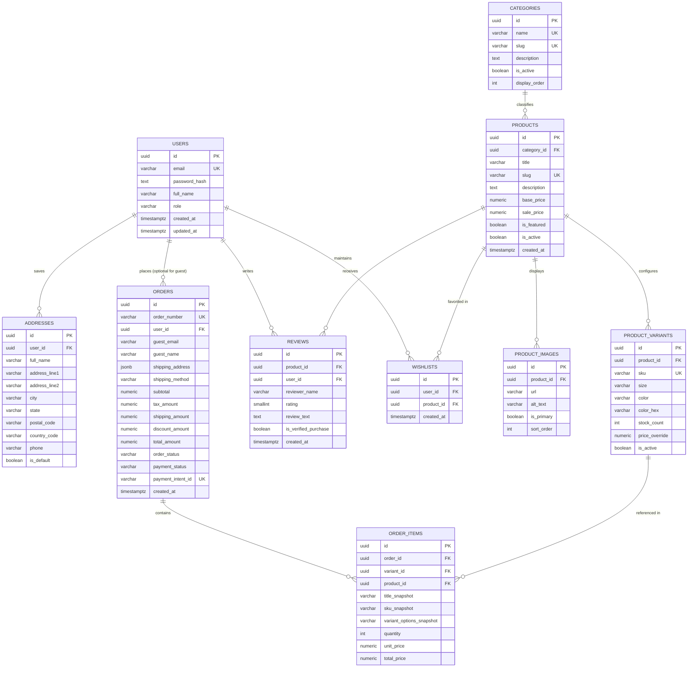

# ApexStore Data Architecture & Database Specification (DATABASE.md)

**Document Version:** 1.0.0  
**Status:** Approved Database Architecture Baseline  
**System:** ApexStore Direct-to-Consumer (D2C) E-Commerce Platform  
**Target Engine:** PostgreSQL 15+ (Production via Neon / Supabase / AWS Aurora PostgreSQL)  
**Companion Documents:** [PRD.md](file:///d:/DATA_SCIENCE_AND_CODING/Self_Projects_Web_Dev/ApexStore/PRD.md), [ARCHITECTURE.md](file:///d:/DATA_SCIENCE_AND_CODING/Self_Projects_Web_Dev/ApexStore/ARCHITECTURE.md), [DESIGN.md](file:///d:/DATA_SCIENCE_AND_CODING/Self_Projects_Web_Dev/ApexStore/DESIGN.md)

---

## 1. Database Technology & Architectural Rationale

ApexStore is built on **PostgreSQL 15+**, leveraging strict ACID guarantees, JSONB document flexibility, and row-level security (RLS).

| Factor | Technical Selection | Operational Rationale |
|---|---|---|
| **DBMS Engine** | **PostgreSQL 15+** | Battle-tested relational engine supporting concurrent transactions, strict serializability options for inventory, native JSONB support, and full-text search indexing. |
| **Object-Relational Mapping (ORM)** | **Prisma ORM** + Typed Raw SQL where locking is critical | Prisma provides compile-time TypeScript type safety across storefront and administrative endpoints. Native SQL is utilized for atomic stock decrement queries (`SELECT FOR UPDATE`). |
| **Connection Pooling & Scale** | **Prisma Accelerate / PgBouncer** | Edge-compatible pooling supporting hundreds of concurrent serverless route handler connections with low latency connection reuse. |
| **Data Integrity & Consistency** | **Strict Foreign Keys & Check Constraints** | Enforced at the database engine level (e.g., check positive stock, rating bounds 1–5, positive monetary amounts) to prevent invalid state regardless of client or API flaws. |

---

## 2. Entity-Relationship (ER) Architecture

ApexStore adheres to a clean, normalized relational design avoiding premature bloat while thoroughly fulfilling guest checkouts, registered customer profiles, product catalog variants, verified reviews, wishlists, and administrative order fulfillments.



---

## 3. Detailed Data Dictionary & Schema DDL

All timestamps are stored in `TIMESTAMPTZ` (UTC). Primary keys use RFC 4122 `UUIDv4` (or `gen_random_uuid()`) to eliminate predictable sequence enumeration attacks and simplify distributed hydration. Monetary values are strictly stored as `NUMERIC(10, 2)`.

### 3.1 Custom Enumerations & Types

```sql
-- Role-based access control
CREATE TYPE user_role AS ENUM ('CUSTOMER', 'SUPPORT', 'ADMIN');

-- Order lifecycle tracking (PRD Section 3.6 / 3.7)
CREATE TYPE order_status AS ENUM (
    'PENDING',
    'CONFIRMED',
    'PROCESSING',
    'SHIPPED',
    'DELIVERED',
    'CANCELLED',
    'REFUNDED'
);

-- Payment lifecycle tracking (Stripe integration)
CREATE TYPE payment_status AS ENUM (
    'REQUIRES_PAYMENT_METHOD',
    'PENDING',
    'SUCCEEDED',
    'FAILED',
    'REFUNDED'
);
```

---

### 3.2 Tables and Columns

#### 1. `users`
Stores customer accounts and store administrators. Supports guest conversion to registered users.

| Column | Type | Nullable | Default | Constraints & Description |
|---|---|:---:|---|---|
| `id` | `UUID` | No | `gen_random_uuid()` | Primary Key |
| `email` | `VARCHAR(255)` | No | - | Unique, normalized to lowercase |
| `password_hash` | `TEXT` | Yes | `NULL` | Nullable for SSO/OAuth users or guest-created stub accounts |
| `full_name` | `VARCHAR(150)` | Yes | `NULL` | Customer contact name |
| `role` | `user_role` | No | `'CUSTOMER'` | Authorization tier (`CUSTOMER`, `SUPPORT`, `ADMIN`) |
| `phone` | `VARCHAR(32)` | Yes | `NULL` | Contact phone for shipping notifications |
| `created_at` | `TIMESTAMPTZ` | No | `NOW()` | Account creation timestamp |
| `updated_at` | `TIMESTAMPTZ` | No | `NOW()` | Auto-updated on record changes |

#### 2. `addresses`
Saved customer shipping/billing addresses for 1-click repeat checkout.

| Column | Type | Nullable | Default | Constraints & Description |
|---|---|:---:|---|---|
| `id` | `UUID` | No | `gen_random_uuid()` | Primary Key |
| `user_id` | `UUID` | No | - | Foreign Key $\rightarrow$ `users(id)` ON DELETE CASCADE |
| `full_name` | `VARCHAR(150)` | No | - | Recipient name |
| `address_line1` | `VARCHAR(255)` | No | - | Street address, building number |
| `address_line2` | `VARCHAR(255)` | Yes | `NULL` | Suite, unit, apartment |
| `city` | `VARCHAR(100)` | No | - | City / locality |
| `state` | `VARCHAR(100)` | No | - | State / province / region |
| `postal_code` | `VARCHAR(20)` | No | - | ZIP or postal code |
| `country_code` | `CHAR(2)` | No | `'US'` | ISO 3166-1 alpha-2 code |
| `phone` | `VARCHAR(32)` | Yes | `NULL` | Delivery contact phone |
| `is_default` | `BOOLEAN` | No | `false` | Indicates default shipping destination |
| `created_at` | `TIMESTAMPTZ` | No | `NOW()` | Row creation timestamp |

#### 3. `categories`
Hierarchical product categories for catalog browsing and navigation pills.

| Column | Type | Nullable | Default | Constraints & Description |
|---|---|:---:|---|---|
| `id` | `UUID` | No | `gen_random_uuid()` | Primary Key |
| `name` | `VARCHAR(100)` | No | - | Unique category name (e.g., "Apparel", "Tech") |
| `slug` | `VARCHAR(120)` | No | - | Unique URL-safe identifier (e.g., "apparel", "tech") |
| `description` | `TEXT` | Yes | `NULL` | SEO catalog description |
| `display_order` | `INT` | No | `0` | Header navigation ordering index |
| `is_active` | `BOOLEAN` | No | `true` | Visibility switch for seasonal drops |
| `created_at` | `TIMESTAMPTZ` | No | `NOW()` | Timestamp |

#### 4. `products`
The core catalog item. Contains editorial copy, base pricing, and category grouping.

| Column | Type | Nullable | Default | Constraints & Description |
|---|---|:---:|---|---|
| `id` | `UUID` | No | `gen_random_uuid()` | Primary Key |
| `category_id` | `UUID` | No | - | Foreign Key $\rightarrow$ `categories(id)` ON RESTRICT |
| `title` | `VARCHAR(255)` | No | - | Product display title |
| `slug` | `VARCHAR(280)` | No | - | Unique URL slug |
| `description` | `TEXT` | No | - | Markdown / rich text description |
| `base_price` | `NUMERIC(10, 2)` | No | - | `CHECK (base_price >= 0.00)` |
| `sale_price` | `NUMERIC(10, 2)` | Yes | `NULL` | `CHECK (sale_price IS NULL OR sale_price < base_price)` |
| `is_featured` | `BOOLEAN` | No | `false` | Highlighted on homepage hero/trending carousel |
| `is_active` | `BOOLEAN` | No | `true` | Soft-publish toggle |
| `created_at` | `TIMESTAMPTZ` | No | `NOW()` | Creation timestamp |
| `updated_at` | `TIMESTAMPTZ` | No | `NOW()` | Updated timestamp |

#### 5. `product_images`
Media assets stored in Cloudinary / S3 with CDN references and alt accessibility tags.

| Column | Type | Nullable | Default | Constraints & Description |
|---|---|:---:|---|---|
| `id` | `UUID` | No | `gen_random_uuid()` | Primary Key |
| `product_id` | `UUID` | No | - | Foreign Key $\rightarrow$ `products(id)` ON DELETE CASCADE |
| `url` | `TEXT` | No | - | Full CDN URL |
| `alt_text` | `VARCHAR(255)` | No | - | WCAG 2.1 AA screen-reader text |
| `is_primary` | `BOOLEAN` | No | `false` | Primary storefront card thumbnail |
| `sort_order` | `INT` | No | `0` | Order in PDP thumbnail strip |

#### 6. `product_variants`
Manages inventory SKUs by color, size, and stock count. Guarantees inventory atomicity.

| Column | Type | Nullable | Default | Constraints & Description |
|---|---|:---:|---|---|
| `id` | `UUID` | No | `gen_random_uuid()` | Primary Key |
| `product_id` | `UUID` | No | - | Foreign Key $\rightarrow$ `products(id)` ON DELETE CASCADE |
| `sku` | `VARCHAR(64)` | No | - | Unique SKU (e.g., "APX-TOP-BLK-M") |
| `size` | `VARCHAR(32)` | Yes | `NULL` | Size descriptor ("XS", "S", "M", "L", "XL") |
| `color` | `VARCHAR(64)` | Yes | `NULL` | Color name ("Midnight Black", "Sage") |
| `color_hex` | `CHAR(7)` | Yes | `NULL` | Hex value for swatch UI (e.g. `"#18181b"`) |
| `stock_count` | `INT` | No | `0` | `CHECK (stock_count >= 0)` Live physical stock |
| `price_override`| `NUMERIC(10, 2)` | Yes | `NULL` | Variant-specific price if different from `base_price` |
| `is_active` | `BOOLEAN` | No | `true` | Variant availability toggle |

#### 7. `orders`
Immutable sales orders supporting both guest checkouts and authenticated customer histories.

| Column | Type | Nullable | Default | Constraints & Description |
|---|---|:---:|---|---|
| `id` | `UUID` | No | `gen_random_uuid()` | Primary Key |
| `order_number` | `VARCHAR(32)` | No | - | Human-facing reference (e.g., `"APX-98241"`), Unique |
| `user_id` | `UUID` | Yes | `NULL` | Foreign Key $\rightarrow$ `users(id)` ON DELETE SET NULL |
| `customer_email`| `VARCHAR(255)` | No | - | Shipping & invoice recipient |
| `customer_name` | `VARCHAR(150)` | No | - | Contact person name |
| `shipping_address`| `JSONB` | No | - | Immutable snapshot of address at time of purchase |
| `shipping_method` | `VARCHAR(64)` | No | `'Standard'` | Selected tier ("Standard", "Express") |
| `subtotal` | `NUMERIC(10, 2)` | No | - | Items sum |
| `tax_amount` | `NUMERIC(10, 2)` | No | `0.00` | Estimated VAT / Sales tax |
| `shipping_amount`| `NUMERIC(10, 2)`| No | `0.00` | Shipping fee charge |
| `discount_amount`| `NUMERIC(10, 2)`| No | `0.00` | Deductions from promotional vouchers |
| `total_amount` | `NUMERIC(10, 2)` | No | - | `CHECK (total_amount = subtotal + tax_amount + shipping_amount - discount_amount)` |
| `order_status` | `order_status` | No | `'PENDING'` | Operational fulfillment state |
| `payment_status`| `payment_status` | No | `'PENDING'` | Stripe payment intent state |
| `payment_intent_id`| `VARCHAR(128)` | Yes | `NULL` | Stripe PaymentIntent ID (`pi_...`), Unique |
| `tracking_number` | `VARCHAR(128)` | Yes | `NULL` | Courier tracking code (DHL, FedEx, UPS) |
| `created_at` | `TIMESTAMPTZ` | No | `NOW()` | Timestamp order placed |
| `updated_at` | `TIMESTAMPTZ` | No | `NOW()` | Timestamp status modified |

#### 8. `order_items`
Itemized lines locked at purchase time. Ensures financial ledger immutability even if catalog prices change.

| Column | Type | Nullable | Default | Constraints & Description |
|---|---|:---:|---|---|
| `id` | `UUID` | No | `gen_random_uuid()` | Primary Key |
| `order_id` | `UUID` | No | - | Foreign Key $\rightarrow$ `orders(id)` ON DELETE CASCADE |
| `variant_id` | `UUID` | Yes | `NULL` | Foreign Key $\rightarrow$ `product_variants(id)` ON DELETE SET NULL |
| `product_id` | `UUID` | Yes | `NULL` | Foreign Key $\rightarrow$ `products(id)` ON DELETE SET NULL |
| `title_snapshot`| `VARCHAR(255)` | No | - | Historical copy of product title |
| `sku_snapshot` | `VARCHAR(64)` | No | - | Historical copy of variant SKU |
| `variant_options`| `VARCHAR(128)` | Yes | `NULL` | Snapshot of selections (e.g. "Color: Black, Size: M") |
| `quantity` | `INT` | No | `1` | `CHECK (quantity > 0)` |
| `unit_price` | `NUMERIC(10, 2)` | No | - | `CHECK (unit_price >= 0.00)` Price per unit at purchase |
| `total_price` | `NUMERIC(10, 2)` | No | - | `CHECK (total_price = unit_price * quantity)` |

#### 9. `reviews`
Verified buyer and visitor product reviews with star ratings (1 to 5).

| Column | Type | Nullable | Default | Constraints & Description |
|---|---|:---:|---|---|
| `id` | `UUID` | No | `gen_random_uuid()` | Primary Key |
| `product_id` | `UUID` | No | - | Foreign Key $\rightarrow$ `products(id)` ON DELETE CASCADE |
| `user_id` | `UUID` | Yes | `NULL` | Foreign Key $\rightarrow$ `users(id)` ON DELETE SET NULL |
| `reviewer_name` | `VARCHAR(100)` | No | - | Display name of reviewer |
| `rating` | `SMALLINT` | No | - | `CHECK (rating BETWEEN 1 AND 5)` |
| `comment` | `TEXT` | No | - | Customer feedback body |
| `is_verified` | `BOOLEAN` | No | `false` | True if linked to delivered order of product |
| `created_at` | `TIMESTAMPTZ` | No | `NOW()` | Publication timestamp |

#### 10. `wishlists`
Customer saved items with cross-device sync.

| Column | Type | Nullable | Default | Constraints & Description |
|---|---|:---:|---|---|
| `id` | `UUID` | No | `gen_random_uuid()` | Primary Key |
| `user_id` | `UUID` | No | - | Foreign Key $\rightarrow$ `users(id)` ON DELETE CASCADE |
| `product_id` | `UUID` | No | - | Foreign Key $\rightarrow$ `products(id)` ON DELETE CASCADE |
| `created_at` | `TIMESTAMPTZ` | No | `NOW()` | Creation timestamp |

---

## 4. Complete PostgreSQL DDL Script

```sql
-- Enable UUID extension
CREATE EXTENSION IF NOT EXISTS "pgcrypto";

-- Enums
CREATE TYPE user_role AS ENUM ('CUSTOMER', 'SUPPORT', 'ADMIN');
CREATE TYPE order_status AS ENUM (
    'PENDING', 'CONFIRMED', 'PROCESSING', 'SHIPPED', 'DELIVERED', 'CANCELLED', 'REFUNDED'
);
CREATE TYPE payment_status AS ENUM (
    'REQUIRES_PAYMENT_METHOD', 'PENDING', 'SUCCEEDED', 'FAILED', 'REFUNDED'
);

-- Users
CREATE TABLE users (
    id UUID PRIMARY KEY DEFAULT gen_random_uuid(),
    email VARCHAR(255) NOT NULL UNIQUE,
    password_hash TEXT NULL,
    full_name VARCHAR(150) NULL,
    role user_role NOT NULL DEFAULT 'CUSTOMER',
    phone VARCHAR(32) NULL,
    created_at TIMESTAMPTZ NOT NULL DEFAULT NOW(),
    updated_at TIMESTAMPTZ NOT NULL DEFAULT NOW(),
    CONSTRAINT chk_users_email_format CHECK (email ~* '^[A-Za-z0-9._%+-]+@[A-Za-z0-9.-]+\.[A-Za-z]{2,}$')
);

-- Addresses
CREATE TABLE addresses (
    id UUID PRIMARY KEY DEFAULT gen_random_uuid(),
    user_id UUID NOT NULL REFERENCES users(id) ON DELETE CASCADE,
    full_name VARCHAR(150) NOT NULL,
    address_line1 VARCHAR(255) NOT NULL,
    address_line2 VARCHAR(255) NULL,
    city VARCHAR(100) NOT NULL,
    state VARCHAR(100) NOT NULL,
    postal_code VARCHAR(20) NOT NULL,
    country_code CHAR(2) NOT NULL DEFAULT 'US',
    phone VARCHAR(32) NULL,
    is_default BOOLEAN NOT NULL DEFAULT false,
    created_at TIMESTAMPTZ NOT NULL DEFAULT NOW()
);

-- Categories
CREATE TABLE categories (
    id UUID PRIMARY KEY DEFAULT gen_random_uuid(),
    name VARCHAR(100) NOT NULL UNIQUE,
    slug VARCHAR(120) NOT NULL UNIQUE,
    description TEXT NULL,
    display_order INT NOT NULL DEFAULT 0,
    is_active BOOLEAN NOT NULL DEFAULT true,
    created_at TIMESTAMPTZ NOT NULL DEFAULT NOW()
);

-- Products
CREATE TABLE products (
    id UUID PRIMARY KEY DEFAULT gen_random_uuid(),
    category_id UUID NOT NULL REFERENCES categories(id) ON DELETE RESTRICT,
    title VARCHAR(255) NOT NULL,
    slug VARCHAR(280) NOT NULL UNIQUE,
    description TEXT NOT NULL,
    base_price NUMERIC(10, 2) NOT NULL,
    sale_price NUMERIC(10, 2) NULL,
    is_featured BOOLEAN NOT NULL DEFAULT false,
    is_active BOOLEAN NOT NULL DEFAULT true,
    created_at TIMESTAMPTZ NOT NULL DEFAULT NOW(),
    updated_at TIMESTAMPTZ NOT NULL DEFAULT NOW(),
    CONSTRAINT chk_products_base_price CHECK (base_price >= 0.00),
    CONSTRAINT chk_products_sale_price CHECK (sale_price IS NULL OR sale_price < base_price)
);

-- Product Images
CREATE TABLE product_images (
    id UUID PRIMARY KEY DEFAULT gen_random_uuid(),
    product_id UUID NOT NULL REFERENCES products(id) ON DELETE CASCADE,
    url TEXT NOT NULL,
    alt_text VARCHAR(255) NOT NULL,
    is_primary BOOLEAN NOT NULL DEFAULT false,
    sort_order INT NOT NULL DEFAULT 0
);

-- Product Variants
CREATE TABLE product_variants (
    id UUID PRIMARY KEY DEFAULT gen_random_uuid(),
    product_id UUID NOT NULL REFERENCES products(id) ON DELETE CASCADE,
    sku VARCHAR(64) NOT NULL UNIQUE,
    size VARCHAR(32) NULL,
    color VARCHAR(64) NULL,
    color_hex CHAR(7) NULL,
    stock_count INT NOT NULL DEFAULT 0,
    price_override NUMERIC(10, 2) NULL,
    is_active BOOLEAN NOT NULL DEFAULT true,
    CONSTRAINT chk_variants_stock_count CHECK (stock_count >= 0),
    CONSTRAINT chk_variants_price_override CHECK (price_override IS NULL OR price_override >= 0.00),
    CONSTRAINT chk_variants_color_hex CHECK (color_hex IS NULL OR color_hex ~* '^#[0-9A-Fa-f]{6}$')
);

-- Orders
CREATE TABLE orders (
    id UUID PRIMARY KEY DEFAULT gen_random_uuid(),
    order_number VARCHAR(32) NOT NULL UNIQUE,
    user_id UUID NULL REFERENCES users(id) ON DELETE SET NULL,
    customer_email VARCHAR(255) NOT NULL,
    customer_name VARCHAR(150) NOT NULL,
    shipping_address JSONB NOT NULL,
    shipping_method VARCHAR(64) NOT NULL DEFAULT 'Standard',
    subtotal NUMERIC(10, 2) NOT NULL,
    tax_amount NUMERIC(10, 2) NOT NULL DEFAULT 0.00,
    shipping_amount NUMERIC(10, 2) NOT NULL DEFAULT 0.00,
    discount_amount NUMERIC(10, 2) NOT NULL DEFAULT 0.00,
    total_amount NUMERIC(10, 2) NOT NULL,
    order_status order_status NOT NULL DEFAULT 'PENDING',
    payment_status payment_status NOT NULL DEFAULT 'PENDING',
    payment_intent_id VARCHAR(128) NULL UNIQUE,
    tracking_number VARCHAR(128) NULL,
    created_at TIMESTAMPTZ NOT NULL DEFAULT NOW(),
    updated_at TIMESTAMPTZ NOT NULL DEFAULT NOW(),
    CONSTRAINT chk_orders_amounts CHECK (
        subtotal >= 0.00 AND tax_amount >= 0.00 AND shipping_amount >= 0.00 AND discount_amount >= 0.00
    ),
    CONSTRAINT chk_orders_total_calc CHECK (
        total_amount = (subtotal + tax_amount + shipping_amount - discount_amount)
    )
);

-- Order Items
CREATE TABLE order_items (
    id UUID PRIMARY KEY DEFAULT gen_random_uuid(),
    order_id UUID NOT NULL REFERENCES orders(id) ON DELETE CASCADE,
    variant_id UUID NULL REFERENCES product_variants(id) ON DELETE SET NULL,
    product_id UUID NULL REFERENCES products(id) ON DELETE SET NULL,
    title_snapshot VARCHAR(255) NOT NULL,
    sku_snapshot VARCHAR(64) NOT NULL,
    variant_options VARCHAR(128) NULL,
    quantity INT NOT NULL DEFAULT 1,
    unit_price NUMERIC(10, 2) NOT NULL,
    total_price NUMERIC(10, 2) NOT NULL,
    CONSTRAINT chk_order_items_qty CHECK (quantity > 0),
    CONSTRAINT chk_order_items_unit_price CHECK (unit_price >= 0.00),
    CONSTRAINT chk_order_items_total CHECK (total_price = unit_price * quantity)
);

-- Reviews
CREATE TABLE reviews (
    id UUID PRIMARY KEY DEFAULT gen_random_uuid(),
    product_id UUID NOT NULL REFERENCES products(id) ON DELETE CASCADE,
    user_id UUID NULL REFERENCES users(id) ON DELETE SET NULL,
    reviewer_name VARCHAR(100) NOT NULL,
    rating SMALLINT NOT NULL,
    comment TEXT NOT NULL,
    is_verified BOOLEAN NOT NULL DEFAULT false,
    created_at TIMESTAMPTZ NOT NULL DEFAULT NOW(),
    CONSTRAINT chk_reviews_rating CHECK (rating BETWEEN 1 AND 5)
);

-- Wishlists
CREATE TABLE wishlists (
    id UUID PRIMARY KEY DEFAULT gen_random_uuid(),
    user_id UUID NOT NULL REFERENCES users(id) ON DELETE CASCADE,
    product_id UUID NOT NULL REFERENCES products(id) ON DELETE CASCADE,
    created_at TIMESTAMPTZ NOT NULL DEFAULT NOW(),
    CONSTRAINT uq_wishlists_user_product UNIQUE (user_id, product_id)
);
```

---

## 5. Performance Indexes & Query Optimization

Indexes are specifically mapped to query patterns defined in **PRD.md** (Instant client search, multi-faceted filtering, stock checks, order lookup, and customer dashboards).

```sql
-- 1. Full-Text Search on Products (FR-201: Instant debounced catalog search)
-- Uses GIN index on generated tsvector combining title and description
ALTER TABLE products ADD COLUMN search_vector tsvector 
    GENERATED ALWAYS AS (
        setweight(to_tsvector('english', coalesce(title, '')), 'A') || 
        setweight(to_tsvector('english', coalesce(description, '')), 'B')
    ) STORED;

CREATE INDEX idx_products_search ON products USING GIN (search_vector);

-- 2. Faceted Catalog Queries (FR-202 & FR-203: Filtering by category, active status, price sort)
CREATE INDEX idx_products_category_active_price ON products (category_id, is_active, base_price);
CREATE INDEX idx_products_featured ON products (is_featured) WHERE is_active = true;
CREATE INDEX idx_products_created_at ON products (created_at DESC);

-- 3. Product Variant & Fast Inventory Decrement (FR-302, NFR-203: Lock & Check stock by SKU/ID)
CREATE INDEX idx_variants_product_id ON product_variants (product_id);
CREATE INDEX idx_variants_sku ON product_variants (sku);

-- 4. Media Gallery lookup by product sort order (FR-301)
CREATE INDEX idx_product_images_product_order ON product_images (product_id, sort_order ASC);

-- 5. Customer Dashboard & Order Timeline (FR-601, FR-702)
CREATE INDEX idx_orders_user_created ON orders (user_id, created_at DESC) WHERE user_id IS NOT NULL;
CREATE INDEX idx_orders_order_number ON orders (order_number);
CREATE INDEX idx_orders_payment_intent ON orders (payment_intent_id);
CREATE INDEX idx_orders_status ON orders (order_status, created_at DESC);

-- 6. Order Line Items lookup (FR-505)
CREATE INDEX idx_order_items_order_id ON order_items (order_id);

-- 7. Verified Reviews Breakdown & PDP Display (FR-305)
CREATE INDEX idx_reviews_product_created ON reviews (product_id, created_at DESC);

-- 8. Customer Saved Addresses
CREATE INDEX idx_addresses_user_default ON addresses (user_id, is_default);
```

---

## 6. Atomic Transaction Handling & Race Conditions

### 6.1 Strict Inventory Decrement (Preventing Overselling)

In high-concurrency drop scenarios (e.g., promotional campaigns), two checkouts could attempt to claim the last available unit simultaneously. ApexStore prevents overselling at the database engine level using atomic conditional updates or row-level locking.

#### Approach A: Direct Atomic SQL Decrement (Recommended)
```sql
-- Atomically decrements stock if and only if sufficient inventory exists.
-- Returns the modified row. If 0 rows are returned, stock is exhausted.
UPDATE product_variants
SET stock_count = stock_count - :purchase_quantity
WHERE id = :variant_id
  AND stock_count >= :purchase_quantity
RETURNING id, stock_count;
```

#### Approach B: Explicit Transactional Lock (`SELECT FOR UPDATE`)
```sql
BEGIN TRANSACTION ISOLATION LEVEL READ COMMITTED;

-- Lock target variant rows exclusively
SELECT id, stock_count 
FROM product_variants 
WHERE id = :variant_id 
FOR UPDATE;

-- Validate in application: if stock_count < requested_qty, abort with ROLLBACK;

UPDATE product_variants 
SET stock_count = stock_count - :requested_qty 
WHERE id = :variant_id;

INSERT INTO orders (...) VALUES (...);
INSERT INTO order_items (...) VALUES (...);

COMMIT;
```

---

## 7. Row-Level Security (RLS) & Authorization

When using PostgreSQL directly or through Supabase / Neon, Row-Level Security ensures uncompromised tenant isolation and protects customer order records.

```sql
-- Enable RLS on sensitive tables
ALTER TABLE users ENABLE ROW LEVEL SECURITY;
ALTER TABLE addresses ENABLE ROW LEVEL SECURITY;
ALTER TABLE orders ENABLE ROW LEVEL SECURITY;
ALTER TABLE order_items ENABLE ROW LEVEL SECURITY;
ALTER TABLE wishlists ENABLE ROW LEVEL SECURITY;
ALTER TABLE reviews ENABLE ROW LEVEL SECURITY;

-- Catalog tables remain globally readable
ALTER TABLE categories ENABLE ROW LEVEL SECURITY;
ALTER TABLE products ENABLE ROW LEVEL SECURITY;
ALTER TABLE product_images ENABLE ROW LEVEL SECURITY;
ALTER TABLE product_variants ENABLE ROW LEVEL SECURITY;

-- 1. Public Catalog Read Policies
CREATE POLICY "Public read active categories" ON categories 
    FOR SELECT USING (is_active = true);

CREATE POLICY "Public read active products" ON products 
    FOR SELECT USING (is_active = true);

CREATE POLICY "Public read product images" ON product_images 
    FOR SELECT USING (true);

CREATE POLICY "Public read active variants" ON product_variants 
    FOR SELECT USING (is_active = true);

CREATE POLICY "Public read reviews" ON reviews 
    FOR SELECT USING (true);

-- 2. Customer User Profile & Address Policies
CREATE POLICY "Users read own profile" ON users 
    FOR SELECT USING (id = auth.uid() OR auth.jwt() ->> 'role' IN ('ADMIN', 'SUPPORT'));

CREATE POLICY "Users update own profile" ON users 
    FOR UPDATE USING (id = auth.uid());

CREATE POLICY "Users access own addresses" ON addresses 
    FOR ALL USING (user_id = auth.uid());

-- 3. Customer Wishlist Policies
CREATE POLICY "Users manage own wishlist" ON wishlists 
    FOR ALL USING (user_id = auth.uid());

-- 4. Orders Policies (Strict Isolation)
-- Customers can only read orders where user_id matches their token
CREATE POLICY "Users read own orders" ON orders 
    FOR SELECT USING (
        user_id = auth.uid() 
        OR auth.jwt() ->> 'role' IN ('ADMIN', 'SUPPORT')
    );

-- Order Items accessible if the user owns the parent order
CREATE POLICY "Users read own order items" ON order_items 
    FOR SELECT USING (
        EXISTS (
            SELECT 1 FROM orders 
            WHERE orders.id = order_items.order_id 
              AND (orders.user_id = auth.uid() OR auth.jwt() ->> 'role' IN ('ADMIN', 'SUPPORT'))
        )
    );

-- 5. Admin / Support Full Management Policies
CREATE POLICY "Admin full categories" ON categories FOR ALL USING (auth.jwt() ->> 'role' = 'ADMIN');
CREATE POLICY "Admin full products" ON products FOR ALL USING (auth.jwt() ->> 'role' = 'ADMIN');
CREATE POLICY "Admin full variants" ON product_variants FOR ALL USING (auth.jwt() ->> 'role' = 'ADMIN');
CREATE POLICY "Admin manage orders" ON orders FOR ALL USING (auth.jwt() ->> 'role' IN ('ADMIN', 'SUPPORT'));
```

---

## 8. Sensitive-Data Handling & Compliance

1. **PCI-DSS Compliance (Zero Card Storage):**
   * No credit card numbers, CVVs, expiration dates, or PINs are ever ingested or stored in the database.
   * Only the Stripe external reference token (`payment_intent_id`, e.g., `pi_3MtwBwLkdIwHu7ix28a3tqPa`) is stored for transaction reconciliation.
2. **PII Protection & Encryption at Rest:**
   * All database volumes use AES-256 encryption at rest (managed via AWS KMS / Neon / Supabase).
   * Customer passwords utilize Argon2id or bcrypt hashing with a work factor $\ge 12$. Plaintext passwords never reach storage.
   * `shipping_address` JSONB payloads contain customer address information and are strictly guarded via RLS and TLS 1.3 in-transit encryption.
3. **GDPR / CCPA Right to Erasure:**
   * When an account deletion is requested, `users(id)` is deleted.
   * Associated `addresses` and `wishlists` cascade delete automatically.
   * `orders` retain compliance financial audit records, but `user_id` is set to `NULL`, and customer PII fields can be scrubbed/anonymized (`customer_name = 'Anonymized Customer'`, `customer_email = 'anonymized@deleted.local'`).

---

## 9. Migration & Seeding Strategy

### 9.1 Prisma Schema Specification (`prisma/schema.prisma`)

```prisma
datasource db {
  provider = "postgresql"
  url      = env("DATABASE_URL")
}

generator client {
  provider = "prisma-client-js"
}

enum Role {
  CUSTOMER
  SUPPORT
  ADMIN
}

enum OrderStatus {
  PENDING
  CONFIRMED
  PROCESSING
  SHIPPED
  DELIVERED
  CANCELLED
  REFUNDED
}

enum PaymentStatus {
  REQUIRES_PAYMENT_METHOD
  PENDING
  SUCCEEDED
  FAILED
  REFUNDED
}

model User {
  id           String     @id @default(uuid()) @db.Uuid
  email        String     @unique @db.VarChar(255)
  passwordHash String?    @map("password_hash")
  fullName     String?    @map("full_name") @db.VarChar(150)
  role         Role       @default(CUSTOMER)
  phone        String?    @db.VarChar(32)
  createdAt    DateTime   @default(now()) @map("created_at") @db.Timestamptz
  updatedAt    DateTime   @default(now()) @updatedAt @map("updated_at") @db.Timestamptz

  addresses    Address[]
  orders       Order[]
  reviews      Review[]
  wishlists    Wishlist[]

  @@map("users")
}

model Address {
  id           String   @id @default(uuid()) @db.Uuid
  userId       String   @map("user_id") @db.Uuid
  fullName     String   @map("full_name") @db.VarChar(150)
  addressLine1 String   @map("address_line1") @db.VarChar(255)
  addressLine2 String?  @map("address_line2") @db.VarChar(255)
  city         String   @db.VarChar(100)
  state        String   @db.VarChar(100)
  postalCode   String   @map("postal_code") @db.VarChar(20)
  countryCode  String   @default("US") @map("country_code") @db.Char(2)
  phone        String?  @db.VarChar(32)
  isDefault    Boolean  @default(false) @map("is_default")
  createdAt    DateTime @default(now()) @map("created_at") @db.Timestamptz

  user         User     @relation(fields: [userId], references: [id], onDelete: Cascade)

  @@index([userId, isDefault])
  @@map("addresses")
}

model Category {
  id           String    @id @default(uuid()) @db.Uuid
  name         String    @unique @db.VarChar(100)
  slug         String    @unique @db.VarChar(120)
  description  String?
  displayOrder Int       @default(0) @map("display_order")
  isActive     Boolean   @default(true) @map("is_active")
  createdAt    DateTime  @default(now()) @map("created_at") @db.Timestamptz

  products     Product[]

  @@map("categories")
}

model Product {
  id          String           @id @default(uuid()) @db.Uuid
  categoryId  String           @map("category_id") @db.Uuid
  title       String           @db.VarChar(255)
  slug        String           @unique @db.VarChar(280)
  description String
  basePrice   Decimal          @map("base_price") @db.Decimal(10, 2)
  salePrice   Decimal?         @map("sale_price") @db.Decimal(10, 2)
  isFeatured  Boolean          @default(false) @map("is_featured")
  isActive    Boolean          @default(true) @map("is_active")
  createdAt   DateTime         @default(now()) @map("created_at") @db.Timestamptz
  updatedAt   DateTime         @default(now()) @updatedAt @map("updated_at") @db.Timestamptz

  category    Category         @relation(fields: [categoryId], references: [id], onDelete: Restrict)
  images      ProductImage[]
  variants    ProductVariant[]
  reviews     Review[]
  orderItems  OrderItem[]
  wishlists   Wishlist[]

  @@index([categoryId, isActive, basePrice])
  @@index([isFeatured])
  @@index([createdAt(sort: Desc)])
  @@map("products")
}

model ProductImage {
  id        String   @id @default(uuid()) @db.Uuid
  productId String   @map("product_id") @db.Uuid
  url       String
  altText   String   @map("alt_text") @db.VarChar(255)
  isPrimary Boolean  @default(false) @map("is_primary")
  sortOrder Int      @default(0) @map("sort_order")

  product   Product  @relation(fields: [productId], references: [id], onDelete: Cascade)

  @@index([productId, sortOrder])
  @@map("product_images")
}

model ProductVariant {
  id            String      @id @default(uuid()) @db.Uuid
  productId     String      @map("product_id") @db.Uuid
  sku           String      @unique @db.VarChar(64)
  size          String?     @db.VarChar(32)
  color         String?     @db.VarChar(64)
  colorHex      String?     @map("color_hex") @db.Char(7)
  stockCount    Int         @default(0) @map("stock_count")
  priceOverride Decimal?    @map("price_override") @db.Decimal(10, 2)
  isActive      Boolean     @default(true) @map("is_active")

  product       Product     @relation(fields: [productId], references: [id], onDelete: Cascade)
  orderItems    OrderItem[]

  @@index([productId])
  @@map("product_variants")
}

model Order {
  id              String        @id @default(uuid()) @db.Uuid
  orderNumber     String        @unique @map("order_number") @db.VarChar(32)
  userId          String?       @map("user_id") @db.Uuid
  customerEmail   String        @map("customer_email") @db.VarChar(255)
  customerName    String        @map("customer_name") @db.VarChar(150)
  shippingAddress Json          @map("shipping_address")
  shippingMethod  String        @default("Standard") @map("shipping_method") @db.VarChar(64)
  subtotal        Decimal       @db.Decimal(10, 2)
  taxAmount       Decimal       @default(0.00) @map("tax_amount") @db.Decimal(10, 2)
  shippingAmount  Decimal       @default(0.00) @map("shipping_amount") @db.Decimal(10, 2)
  discountAmount  Decimal       @default(0.00) @map("discount_amount") @db.Decimal(10, 2)
  totalAmount     Decimal       @map("total_amount") @db.Decimal(10, 2)
  orderStatus     OrderStatus   @default(PENDING) @map("order_status")
  paymentStatus   PaymentStatus @default(PENDING) @map("payment_status")
  paymentIntentId String?       @unique @map("payment_intent_id") @db.VarChar(128)
  trackingNumber  String?       @map("tracking_number") @db.VarChar(128)
  createdAt       DateTime      @default(now()) @map("created_at") @db.Timestamptz
  updatedAt       DateTime      @default(now()) @updatedAt @map("updated_at") @db.Timestamptz

  user            User?         @relation(fields: [userId], references: [id], onDelete: SetNull)
  items           OrderItem[]

  @@index([userId, createdAt(sort: Desc)])
  @@index([orderStatus, createdAt(sort: Desc)])
  @@map("orders")
}

model OrderItem {
  id             String          @id @default(uuid()) @db.Uuid
  orderId        String          @map("order_id") @db.Uuid
  variantId      String?         @map("variant_id") @db.Uuid
  productId      String?         @map("product_id") @db.Uuid
  titleSnapshot  String          @map("title_snapshot") @db.VarChar(255)
  skuSnapshot    String          @map("sku_snapshot") @db.VarChar(64)
  variantOptions String?         @map("variant_options") @db.VarChar(128)
  quantity       Int             @default(1)
  unitPrice      Decimal         @map("unit_price") @db.Decimal(10, 2)
  totalPrice     Decimal         @map("total_price") @db.Decimal(10, 2)

  order          Order           @relation(fields: [orderId], references: [id], onDelete: Cascade)
  variant        ProductVariant? @relation(fields: [variantId], references: [id], onDelete: SetNull)
  product        Product?        @relation(fields: [productId], references: [id], onDelete: SetNull)

  @@index([orderId])
  @@map("order_items")
}

model Review {
  id           String   @id @default(uuid()) @db.Uuid
  productId    String   @map("product_id") @db.Uuid
  userId       String?  @map("user_id") @db.Uuid
  reviewerName String   @map("reviewer_name") @db.VarChar(100)
  rating       Int      @db.SmallInt
  comment      String
  isVerified   Boolean  @default(false) @map("is_verified")
  createdAt    DateTime @default(now()) @map("created_at") @db.Timestamptz

  product      Product  @relation(fields: [productId], references: [id], onDelete: Cascade)
  user         User?    @relation(fields: [userId], references: [id], onDelete: SetNull)

  @@index([productId, createdAt(sort: Desc)])
  @@map("reviews")
}

model Wishlist {
  id        String   @id @default(uuid()) @db.Uuid
  userId    String   @map("user_id") @db.Uuid
  productId String   @map("product_id") @db.Uuid
  createdAt DateTime @default(now()) @map("created_at") @db.Timestamptz

  user      User     @relation(fields: [userId], references: [id], onDelete: Cascade)
  product   Product  @relation(fields: [productId], references: [id], onDelete: Cascade)

  @@unique([userId, productId])
  @@map("wishlists")
}
```

### 9.2 Migration Workflow
1. **Development Migrations:**
   ```bash
   npx prisma migrate dev --name init_apexstore_schema
   ```
2. **Production Deployment:**
   ```bash
   npx prisma migrate deploy
   ```
   Zero downtime schema evolutions (expanding nullable columns, adding indexes concurrently with `CREATE INDEX CONCURRENTLY` in pure SQL).

### 9.3 Realistic Seed Data (`prisma/seed.ts` specification)
The seed strategy generates an initial, production-like catalog matching the "Minimalist Editorial Luxe" theme from DESIGN.md:
* **Categories:** `Apparel`, `Footwear`, `Accessories`, `Tech & Living`.
* **Products & Variants:** Realistic items (e.g., *"Merino Wool Minimalist Overshirt"*, *"Aero Titanium Chronometer"*, *"Modular Everyday Sling 8L"*) with sizes (`S`, `M`, `L`, `XL`), swatch hex colors (`#18181b`, `#27272a`, `#52525b`, `#eff6ff`), inventory levels (including scarcity tests with `< 5` left), and verified customer reviews.
* **Admin Account:** Default admin seed with Argon2id hashed credentials for fulfillment dashboard access.

---

## 10. Backup, Disaster Recovery & High Availability

| Vector | Production Policy | RPO / RTO Target |
|---|---|---|
| **Automated Daily Backups** | Full encrypted database snapshots performed every 24 hours at 02:00 UTC. Stored across multiple availability zones. | RPO: 24 hours |
| **Point-in-Time Recovery (PITR)** | Continuous Write-Ahead Logging (WAL) archiving with 14-day retention. Enables granular restoration to any second. | **RPO: $< 5\text{ minutes}$** |
| **Disaster Recovery (RTO)** | Automated standby replica failover (Multi-AZ Aurora or Neon branch instant clone). | **RTO: $< 15\text{ minutes}$** |
| **Disaster Drill Verification** | Quarterly automated restore validation into an isolated staging environment to verify index rebuilding and schema integrity. | Verified |
